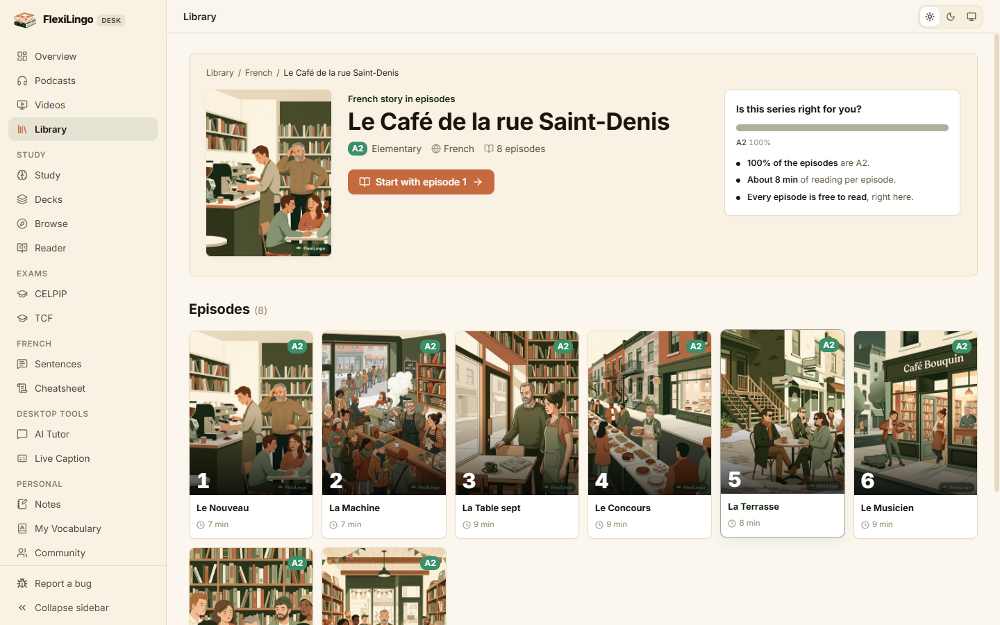
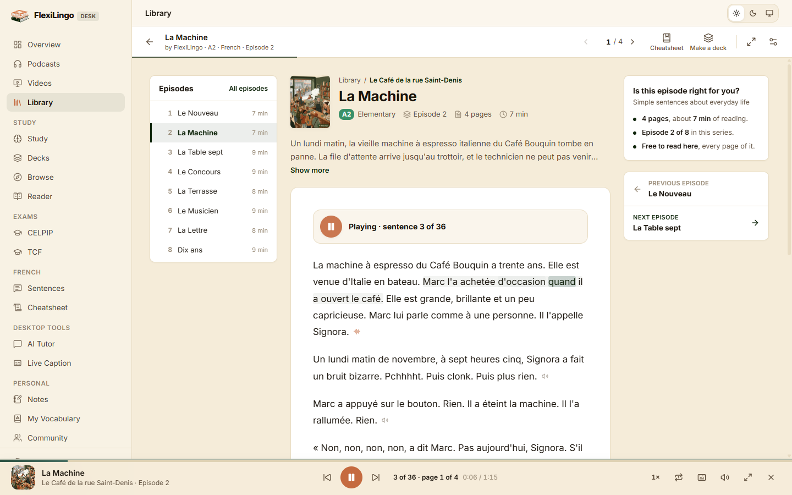
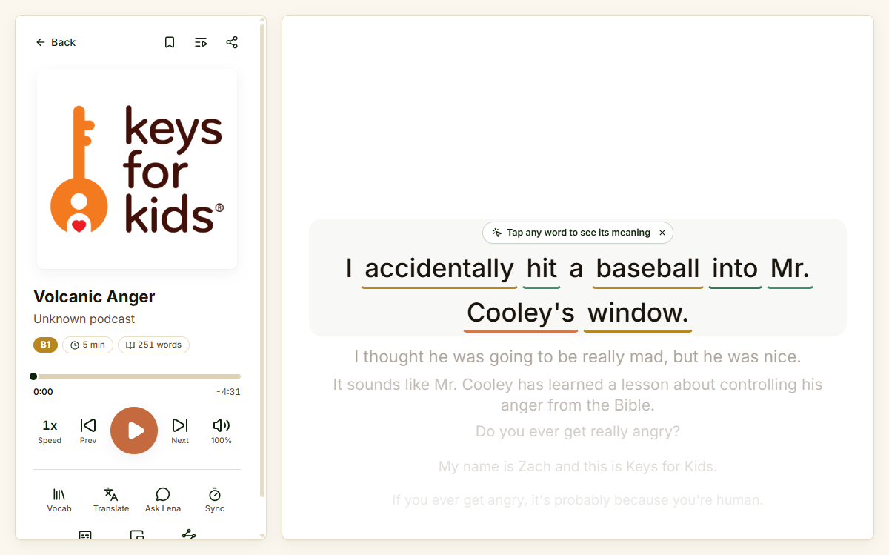
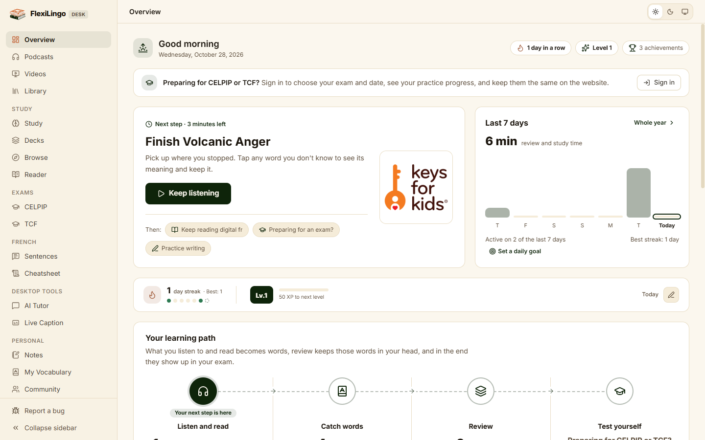
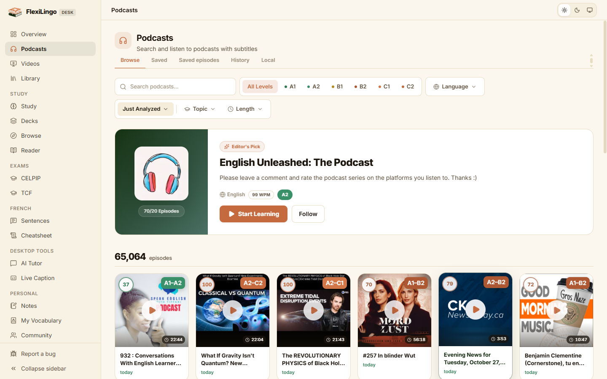

<div align="center">
  <a name="readme-top"></a>

  

  <h1>FlexiLingo Desk</h1>

  FlexiLingo on your computer — read your own PDFs and books, listen to stories and podcasts, review your words and practise for CELPIP and TCF. Your files stay on your computer.

  [![Release][release-badge]][releases-url] [![Website][website-badge]][website-url]

  **[Download for Windows, Mac or Linux][download-url]** · [Website][website-url] · [Report a bug][issues-url]

</div>

---

<p align="center">
  <a href="docs/screenshots/library.png"></a>
</p>

<p align="center">
  <a href="docs/screenshots/reader-listen.png"></a>
  <a href="docs/screenshots/podcast-player.png"></a>
</p>

<p align="center">
  <a href="docs/screenshots/overview.png"></a>
  <a href="docs/screenshots/podcasts.png"></a>
</p>

---

## 📥 Download

Get the app from **[flexilingo.com/products/desktop][download-url]** — one button, with step-by-step install help in eight languages.

| [][download-url]<br>Windows | [][download-url]<br>macOS | [][download-url]<br>Linux |
| :---: | :---: | :---: |
| Windows 10 or 11 (64-bit)<br>`.exe` installer | Apple silicon or Intel<br>`.dmg`, notarized by Apple | Ubuntu 22.04 or newer<br>`.AppImage` · `.deb` · `.rpm` |

The app is free. Some features need a free FlexiLingo account — sign in with the same email you use on the website, and your decks and progress are already there.

**Updates:** from version 0.7.0 the app updates itself — when a new version is ready it asks you, and one click installs it. If you have 0.6 or older, download it once more from the link above.

## ✨ Features

The desktop app looks and works like the [FlexiLingo website][website-url], with the same menu, colours and features.

### Read and listen

| | Feature | What it does |
| :---: | :--- | :--- |
| 📖 | **Reader** | Open your own PDFs and photos (PDF, JPG, PNG, WebP) and tap any word to look it up. Scanned pages become tappable through text recognition that runs on your computer — free, with no page or size limits. Notes, text boxes and marks for filling in exercises, a words panel, "make a deck from this page", and pasted text or web page import. |
| 📚 | **Library** | Graded stories and series in English and French, with seasons and episodes. Narrated pages play a recorded voice with every word highlighted as it is spoken; other pages are read by your computer's voice. |
| 🎧 | **Podcasts** | Search 65,000+ analysed episodes by level, topic, length and language. Subtitles you can tap, subtitle settings, a sync tool, picture-in-picture subtitles, media keys, and search by sentence or meaning. |
| 🎬 | **Videos** | Video lessons with tappable subtitles. |
| ⏯ | **Mini player** | Keeps a podcast, video or book playing while you move around the app, with a real seek bar. |
| 🎙 | **Live caption** | Live transcription of what you hear, with Whisper running on your computer. |

### Learn and review

| | Feature | What it does |
| :---: | :--- | :--- |
| 💬 | **Word dialog** | Translation, dictionary, AI explanation, grammar details, collocations, word family, US and UK pronunciation, and one-tap saving to a deck — the same everywhere in the app. |
| 🗂 | **Decks and review** | The decks from your account, ready-made public decks, and the same daily spaced-repetition review as on the website. |
| 🎧 | **Study** | Daily study with flashcards or shadowing: audio-led repetition that moves on by itself, focus mode, a conjugation panel and a completion report. |
| 🇫🇷 | **French** | A French cheatsheet, a verb conjugator (both work offline once loaded) and sentence practice. |
| ✍️ | **Writing practice** | Write and get feedback on your text. |
| 🤖 | **AI tutor** | A voice conversation partner with role-play scenarios and practice modes. |
| 📒 | **Notes and vocabulary** | Your notes and every word you have saved, in one place. |

### Exams

| | Feature | What it does |
| :---: | :--- | :--- |
| 🍁 | **CELPIP** | Practise a section or sit the whole exam; results with detailed explanations and a coach report with your skill profile. |
| 🇨🇦 | **TCF Canada and TCF Québec** | Practice tests with results and explanations. |

### You and your account

| | Feature | What it does |
| :---: | :--- | :--- |
| 📊 | **Overview** | Your next step, study time, streak, level and learning path. |
| 👤 | **Account** | Profile, XP, achievements, friends, subscription, gift codes, announcements and the community board. |
| 🌍 | **Eight languages** | The app speaks English, Chinese, French, Arabic, Hindi, Persian, German and Vietnamese. |
| 🌗 | **Light and dark** | Light, dark or follow your system. |

## 🔒 Privacy

- **Your files stay on your computer.** PDFs and photos are copied into the app's own folder and are never uploaded. Text recognition for scanned pages runs on your computer.
- **Your AI, by default.** AI features (tutor, writing feedback, Ask Lena, exam explanations, deck-making) use your own AI first: a model running on your computer through [Ollama](https://ollama.com), or your own OpenAI or Anthropic key. FlexiLingo's cloud AI is used only if you turn it on. Exam scores come from the FlexiLingo server.
- **Anonymous usage counts.** The app sends a count when it opens and the names of the screens you use, with the app version, your system and the app language — never your files, text, words or recordings. Turn it off any time in **Settings → General → Usage statistics**.

## 🏗 Architecture

Built with **Tauri 2 (Rust)** and **React 19**. Your library, decks and history live in a local **SQLite** database and sync with your FlexiLingo account when you are online. Updates are signed and delivered through GitHub Releases.

## 🧪 Development

### Prerequisites

- [Rust](https://rustup.rs/) (stable)
- [Node.js](https://nodejs.org/) 22 and [pnpm](https://pnpm.io/) 9
- The [Tauri 2 prerequisites](https://tauri.app/start/prerequisites/) for your system

### Build and run

```bash
# Install frontend dependencies
pnpm install

# Run the app in development mode
pnpm tauri:dev

# Build installers for your system
pnpm tauri:build
```

### Tests

```bash
# Frontend tests (Vitest)
pnpm test

# Rust backend tests
cd src-tauri && cargo test --lib
```

Pushing a `v*` tag builds the Windows and Linux installers on GitHub Actions as a draft release; the Mac build is signed and notarized on a Mac and added to the same release.

## 🔗 Links

- [Download the app][download-url]
- [All versions and release notes][releases-url]
- [FlexiLingo website][website-url]
- [Report a bug][issues-url]

---

[release-badge]: https://img.shields.io/github/v/release/flexilingo/Flexi-Desk?style=flat-square&label=release&color=6B705C
[releases-url]: https://github.com/flexilingo/Flexi-Desk/releases
[download-url]: https://www.flexilingo.com/en/products/desktop
[website-badge]: https://img.shields.io/badge/website-flexilingo.com-6B705C?style=flat-square
[website-url]: https://www.flexilingo.com
[issues-url]: https://github.com/flexilingo/Flexi-Desk/issues
